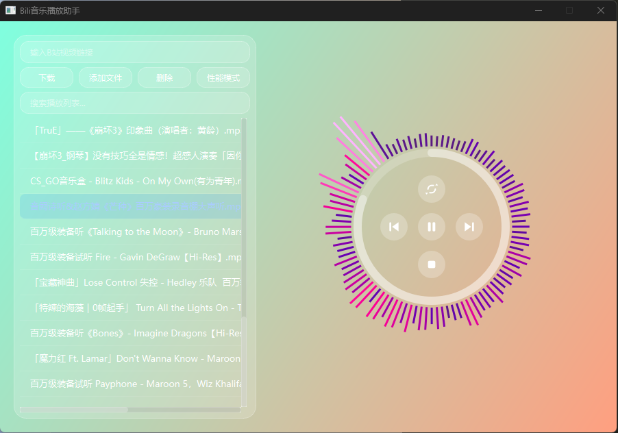

# Bili 音乐播放助手

一个基于 Python 和 PyQt6 的桌面音乐播放器，面向本地音频播放和 B 站视频音频下载场景。项目内置圆形动态频谱、圆形播放进度、播放列表管理、播放模式切换、下载路径与代理设置等功能。



## 主要功能

- 本地音频播放：支持 `mp3`、`wav`、`ogg`、`flac`、`aac`、`m4a` 等常见格式。
- B 站音频下载：输入 Bilibili 视频链接后提取音频并保存到配置的下载目录。
- 实时频谱可视化：播放时基于音频数据绘制圆形动态频谱。
- 播放进度显示：圆形进度条和时间标签同步显示当前播放位置。
- 播放控制：支持播放、暂停、停止、上一首、下一首、音量调节和进度跳转。
- 播放模式：支持顺序播放、随机播放、单曲循环。
- 多播放列表：支持创建、删除、切换播放列表，并持久化保存。
- 播放列表操作：支持搜索、拖拽排序、右键播放、下一首播放、移出列表、打开文件位置和永久删除文件。
- 当前歌曲定位：一键滚动并选中正在播放的歌曲。
- 性能模式：可降低界面刷新压力，适合性能较弱或后台播放场景。
- 均衡器界面：提供 10 段均衡器调节和预设保存入口。

## 环境要求

- Windows 为主要开发和测试平台。
- Python 3.8 及以上。
- 系统可执行 `ffmpeg` 命令，需将 FFmpeg 加入 `PATH`。
- 可用的音频输出设备。

Python 依赖见 `requirements.txt`：

```bash
pip install -r requirements.txt
```

## 快速运行

```bash
python player.py
```

首次运行会读取或创建 `config` 目录下的配置文件。B 站下载功能需要网络可访问 Bilibili API；如本地网络需要代理，可在应用设置中填写代理地址。

## 使用说明

1. 点击左侧顶部的添加按钮，打开“添加音乐”窗口。
2. 选择本地音频文件，或输入 B 站视频链接并点击下载。
3. 双击播放列表中的歌曲开始播放。
4. 使用中间控制按钮切换播放、暂停、停止、上一首、下一首。
5. 使用播放模式按钮在顺序、随机、单曲循环之间切换。
6. 拖动进度条区域可跳转播放位置，拖动音量滑块可调节音量。
7. 在播放列表中右键歌曲，可执行下一首播放、打开文件位置、移出播放列表或永久删除文件。
8. 点击“管理播放列表”可创建或删除播放列表。
9. 点击设置按钮可修改下载目录和代理。
10. 点击 `EQ` 可打开均衡器设置。

## 配置文件

配置文件位于 `config` 目录：

| 文件 | 作用 |
| --- | --- |
| `settings.json` | 保存音量、播放模式、上次播放文件、下载目录、代理、均衡器等应用设置。 |
| `playlists.json` | 保存多播放列表数据和当前选中的播放列表。 |
| `playlist.json` | 旧版单播放列表文件；新版本会优先使用 `playlists.json`，必要时迁移旧数据。 |

注意：`config/settings.json` 可能包含本机路径和代理地址，不建议直接提交个人配置。

## 打包

项目提供 Windows 打包脚本：

```powershell
.\packing.bat
```

脚本会调用 PyInstaller，并把 `assets`、`config` 一起打包：

```bash
pyinstaller --windowed --name BiliSpectrumPlayer --add-data "assets;assets" --add-data "config;config" player.py -y
```

默认输出目录为：

```text
dist/BiliSpectrumPlayer/
```

运行其中的 `BiliSpectrumPlayer.exe` 即可启动应用。

如需生成单文件版本，可参考 `packing.bat` 中已注释的 `--onefile` 命令。

## 项目结构

```text
.
├── player.py                         # 主窗口、播放控制、状态持久化
├── backends/
│   ├── bilibili_downloader.py         # B 站视频信息解析与音频下载
│   ├── sd_ffmpeg_provider.py          # FFmpeg 解码与 sounddevice 播放
│   └── spectrum_processor.py          # 频谱数据计算
├── utils/
│   ├── config.py                      # 路径、默认配置和界面常量
│   ├── dialogs.py                     # 添加音乐、播放列表管理、设置、均衡器窗口
│   ├── helpers.py                     # 图标、时间格式化、目录工具
│   ├── playlist_manager.py            # 播放列表持久化与下一首队列
│   ├── playlist_widget.py             # 播放列表 UI 和右键菜单
│   └── ui_components.py               # 频谱、背景、进度条、音量等组件
├── assets/
│   ├── stylesheet.qss                 # Qt 样式
│   └── icons/                         # 控制按钮图标
├── config/                            # 运行配置和播放列表数据
├── readme_src/                        # README 图片资源
├── requirements.txt                   # Python 依赖
├── packing.bat                        # Windows 打包脚本
└── BiliSpectrumPlayer.spec            # PyInstaller 配置
```

## 常见问题

### B 站音频下载失败

请先确认链接是有效的 Bilibili 视频链接，并且当前网络可以访问 B 站。若使用代理，在设置窗口中填写类似 `http://127.0.0.1:7890` 的代理地址。下载和转封装依赖 `ffmpeg`，请确认命令行中可以正常执行 `ffmpeg`。

### 播放失败或没有声音

请确认音频文件存在、格式可被 FFmpeg 识别，并且系统存在可用的默认输出设备。可以先用命令行检查：

```bash
ffmpeg -i your_audio_file.m4a
```

### 非 Windows 平台能否运行

核心逻辑使用 Python、PyQt6、FFmpeg 和 sounddevice，理论上可以在 macOS 或 Linux 上尝试运行；但当前项目主要在 Windows 下开发和打包，非 Windows 平台未作为主要支持目标。

### README 中文显示乱码

请确保编辑器按 UTF-8 打开本文件。

## 许可

本项目采用 MIT License。
